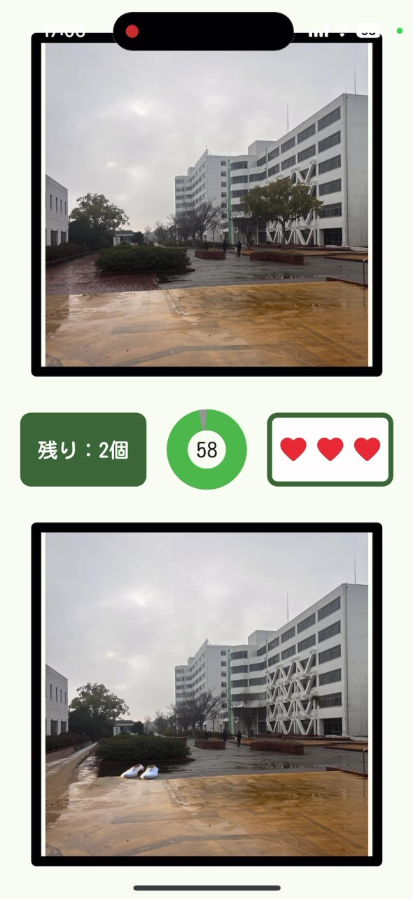
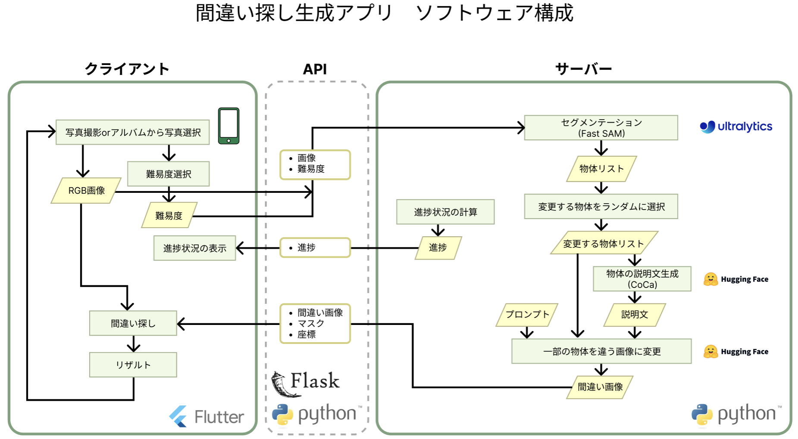

# 間違い探し画像の自動生成（ハッカソン 2025）

ユーザーが撮った写真から、**間違い探しの問題画像を自動で生成する**システムです。写真の中の物体を見つけ、そのいくつかを画像生成 AI で別の物に描き替えることで、「元の写真」と「間違いを含む写真」のペアを作ります。

ハッカソンで開発したアプリのうち、**自分が担当した画像生成の部分（バックエンド）だけ**をまとめたリポジトリです。アプリ本体（画面や遊ぶ部分）はほかのメンバーが担当しました。



*アプリのプレイ画面。上がユーザーが撮った写真、下がこのシステムで生成した間違い探し画像です。*

## システム構成



アプリ全体は、Flutter のクライアント、Flask の API、Python のサーバーで構成されています。このリポジトリは、API とサーバー（図の中央と右側）にあたります。 クライアント（図の左側）は、ほかのメンバーが担当しました。

クライアントから写真と難易度を受け取り、生成の進み具合を通知しながら間違い探し画像を作り、間違い画像・マスク・間違いの座標を返します。

## 処理の流れ

```
入力画像 ──► セグメンテーション ──► 変更する物体の選択 ──► 説明文の生成 ──► 描き替え ──► 間違い探し画像
             (FastSAM)               (難易度で数と大きさ)    (CoCa)            (Stable Diffusion 2
                                                                                Inpainting)
```

1. **セグメンテーション**：FastSAM で、画像の中の物体を切り出します。
2. **変更する物体の選択**：難易度に応じて、大きすぎる物体と小さすぎる物体を除き、残りからランダムに選びます。
3. **説明文の生成**：選んだ物体の画像から、CoCa で説明文を作ります。
4. **描き替え**：説明文や、あらかじめ用意した単語（形容詞 + 名詞）からプロンプトを作り、Stable Diffusion 2 Inpainting で物体の部分だけを描き替えます。
5. **出力**：間違い探し画像、間違いの場所を示すマスク画像、間違いの位置（x, y, 幅, 高さ）のリストを返します。

### 難易度

| 難易度 | 間違いの数 | 変更する物体の大きさ（画像に対する面積比） |
|---|---|---|
| 簡単（0） | 2 | 4% 〜 20% |
| 普通（1） | 4 | 0.9% 〜 4% |
| 難しい（2） | 5 | 0.5% 〜 4% |

難しくなるほど、小さな物体が、周りになじむように描き替えられます。

### プロンプトの作り方

- **簡単**：用意した単語をランダムに組み合わせます（例：「cute, a cat」）。元の物体とまったく違う物になるので、見つけやすくなります。
- **普通**：物体の説明文をそのまま使うか、用意した単語を使うかを、ランダムに選びます。
- **難しい**：物体の説明文をもとに描き替えるので、元の物体と似た物になり、変化が目立ちにくくなります。
- 細長い物体（縦横比が 3 を超える）は、草・空・水などの背景になじむ物に描き替えます。
- 用意した単語は `programs/prepared_prompt.json` にあります。

## モデルの選定

推論時間を短くすることを重視して、モデルを比較して選びました。

### セグメンテーション：FastSAM（Large）

品質は SAM2 より低いものの、推論が SAM2 の 100 倍以上速い FastSAM_Large を採用しました。

| モデル | 推論時間（room.jpg）[s] | 品質 | 検出できる物体の数 | モデルサイズ |
| :------------ | ----------------------------: | :-----: | :-------------------: | ---------: |
| SAM2_Large    |                      215.1906 |  high   |         many          |      428MB |
| SAM2_Base     |                       16.2857 |  high   |         many          |      154MB |
| SAM2_Small    |                       12.6712 |  high   |        normal         |       88MB |
| SAM2_Tiny     |                       12.5818 |  high   |          few          |     74.4MB |
| MobileSAM     |                       28.0082 | medium  |         many          |     38.8MB |
| FastSAM_Small |                        0.1031 |   low   |         many          |     22.7MB |
| **FastSAM_Large** |                    **0.1619** |   low   |         many          |      138MB |

<!-- FIGURE: FastSAM_Large のセグメンテーション結果、マスク、切り出した物体。推奨パス: images/readme/segmentation.jpg -->

### 説明文の生成：CoCa

BLIP2 はモデルが大きく（15 GB）、推論にとても時間がかかるため、CoCa を採用しました。

| モデル | 推論時間 [s] | モデルサイズ |
| :---: | ----------: | ---------: |
| BLIP2 | 1890.17 | 15GB |
| **CoCa** | **2.20** | 2.5GB |

ソファの画像に対する出力の例：

- CoCa：「sofa covers for living room modern elastic slipcovers stretch couch cover sofa covers for 1 2 3 4」
- BLIP2（プロンプト「What is it?」）：「It is a sofa」

### 描き替え：Stable Diffusion 2 Inpainting

マスクで指定した部分だけを描き替えます。1枚あたりの推論時間は約 11 秒でした。

<!-- FIGURE: 切り出した画像、ぼかしたマスク、描き替えた結果（プロンプト "a real dog, sitting, highly detailed, 8k"）。推奨パス: images/readme/inpainting.jpg -->


## リポジトリ構成

```
generation/
├── programs/
│   ├── api.py                   # Flask-SocketIO の API サーバー
│   ├── api_using_colab.py       # Google Colab で動かす版
│   ├── spot_the_diff_maker.py   # 生成処理の全体（物体の選択、プロンプト作成、合成）
│   ├── segmentation.py          # FastSAM によるセグメンテーション
│   ├── captioning.py            # CoCa による説明文の生成
│   ├── change_object.py         # Stable Diffusion 2 Inpainting による描き替え
│   ├── object_info.py           # 物体の情報（位置、大きさ、説明文など）
│   └── prepared_prompt.json     # プロンプトに使う単語
├── images/test_images/          # 動作確認用の画像
├── models/                      # 学習済みモデル
├── Dockerfile
├── requirements.txt
└── LICENSE.md                   # 使用しているモデル・ライブラリのライセンス
```

## 動作環境

- Python 3（PyTorch 2.6 + CUDA 12.6 で開発）

